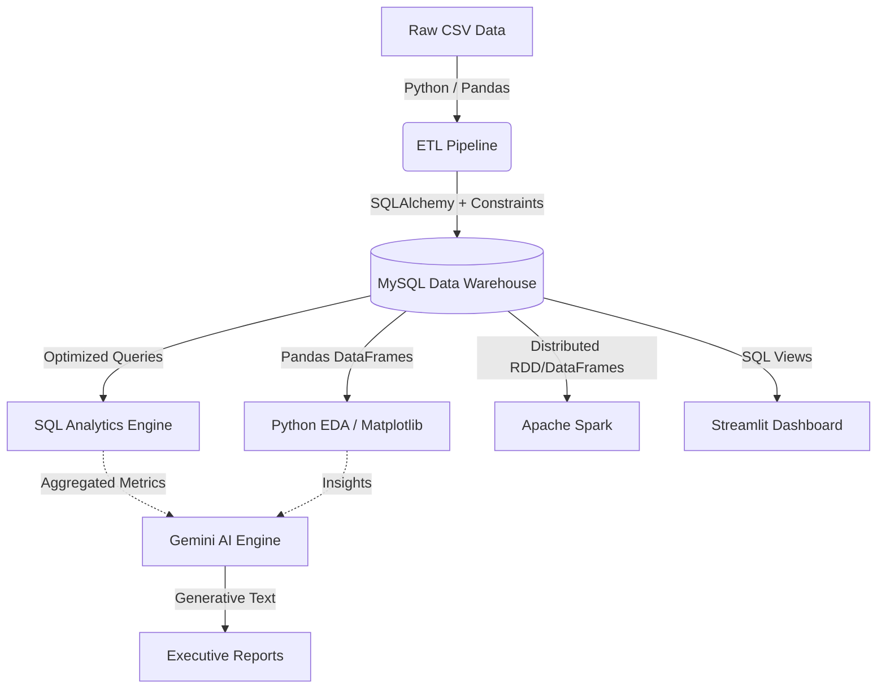

# System Architecture

This document details the data pipeline flow and architectural design patterns used in the AI-Powered Customer Intelligence Platform.

## High-Level Data Flow

The platform employs a decoupled, multi-stage data architecture to ensure fault tolerance and scalability.

## Component Architecture

1. **Extraction & Loading (ETL)**:
   - Data is extracted from local CSV files. 
   - Referential integrity is enforced strictly at the Pandas layer to prevent foreign-key insertion failures at the database layer.

2. **Data Warehouse (MySQL)**:
   - Designed in Third Normal Form (3NF).
   - Core tables heavily indexed on foreign keys and timestamps to optimize complex aggregations and time-series reporting.

3. **Apache Spark**:
   - Deployed for tasks that exceed standard memory bounds.
   - Utilizes `Broadcast` joins for small lookup tables (category translations) and heavily utilizes `Repartitioning` based on chronological dates.

4. **AI Intelligence**:
   - The Gemini API is fed structured JSON outputs originating from the SQL engine.
   - Prompts are dynamically injected to coerce the LLM into generating Root Cause Analyses based purely on the provided context, mitigating hallucination.
