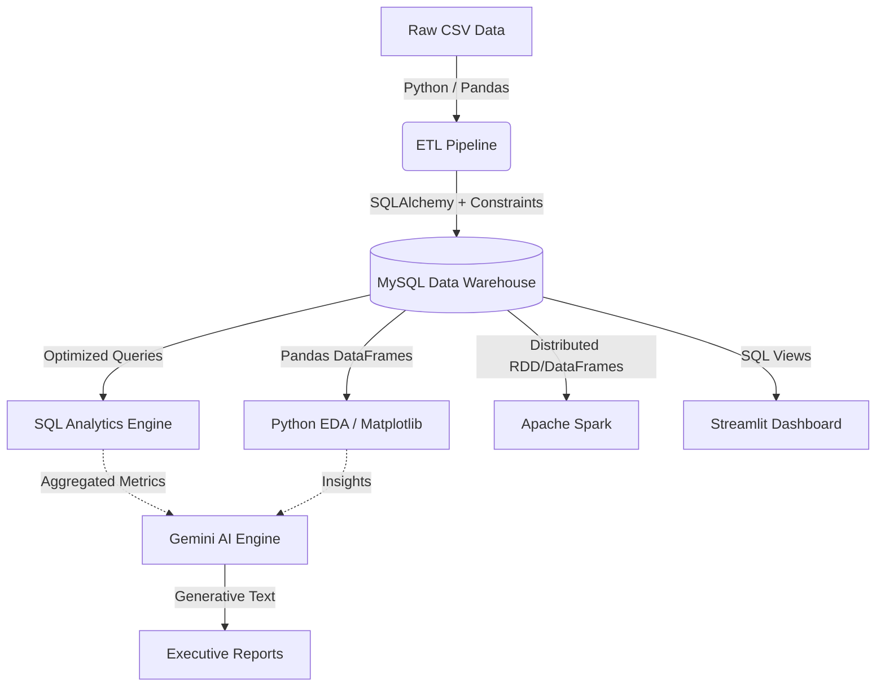

# AI-Powered Customer Intelligence & Sales Analytics Platform


## 📖 Project Overview
The AI-Powered Customer Intelligence & Sales Analytics Platform is an end-to-end, production-ready data engineering and analytics solution. Built on the Olist Brazilian E-Commerce Dataset (100,000+ orders), this platform ingests raw data, models it into a high-performance relational schema, distributes big-data workloads, serves interactive dashboards, and automatically extracts generative AI business insights.

By combining traditional Data Warehousing (MySQL), Big Data Processing (Apache Spark), and modern Generative AI (Google Gemini), this project reduces the time-to-insight for executive reporting from weeks to seconds.

---

## 🏗️ System Architecture & Data Flow

The system follows a modular, decoupled architecture ensuring fault tolerance, data integrity, and horizontal scalability.



### Component Breakdown
1. **Extraction & Loading (ETL)**: Data is ingested via Python/Pandas. Referential integrity is strictly enforced to drop orphaned records before attempting database bulk inserts via SQLAlchemy.
2. **Data Warehouse (MySQL)**: Designed in Third Normal Form (3NF). Core tables are heavily indexed on foreign keys and timestamps to optimize complex aggregations and time-series reporting via CTEs and Window Functions.
3. **Apache Spark**: Deployed to handle memory-intensive distributed workloads. Utilizes `Broadcast` joins for lookup tables and `Repartitioning` based on chronological dates to scale horizontally.
4. **Streamlit Dashboard**: A real-time BI presentation layer leveraging `@st.cache_data` to ensure fluid UI interaction without crushing the database.
5. **AI Intelligence**: The Google Gemini API is fed structured JSON outputs originating from the SQL engine. Prompts are dynamically injected to coerce the LLM into generating accurate Root Cause Analyses, aggressively mitigating AI hallucination.

---

## 🚀 Key Business Features
- **RFM Customer Segmentation**: Identifies VIPs vs churning users based on lifetime value (`total_payment_value`).
- **Distributed Big Data Computing**: Demonstrates Enterprise Scalability by transitioning from local Pandas execution to clustered PySpark DataFrames.
- **Generative AI Root Cause Analysis**: Identifies anomalies in daily sales and outputs actionable strategic recommendations in markdown format.

---

## 🧠 Architectural Defense (Why these tools?)
- **Why MySQL over NoSQL?** E-commerce data is highly relational. MySQL enforces strict ACID compliance and referential integrity through Foreign Keys. While NoSQL offers schema flexibility, it makes the complex multi-table JOINs required for sales analytics highly inefficient.
- **Why Apache Spark?** While Pandas successfully processed the ~100MB dataset locally, it cannot scale beyond the physical RAM of a single node. PySpark ensures the pipeline is capable of processing terabytes of data across a distributed cluster (e.g., AWS EMR) without code changes.
- **Why Gemini AI?** Google's Gemini API offers an exceptionally large context window, allowing us to pass massive, aggregated JSON arrays directly into the prompt without hitting token limits.

---

## 🛠️ Installation & Setup

### 1. Prerequisites
Ensure you have the following installed:
- Python 3.9+
- MySQL Server 8.0+
- Java (Required for Apache Spark)

### 2. Clone & Configure
```bash
git clone https://github.com/yourusername/ai-ecommerce-analytics.git
cd ai-ecommerce-analytics
python -m venv venv

# Windows
venv\Scripts\activate
# Mac/Linux
source venv/bin/activate

pip install -r requirements.txt
```

### 3. Environment Variables
Create a `.env` file in the root directory:
```env
DB_USER=root
DB_PASSWORD=yourpassword
DB_HOST=localhost
DB_PORT=3306
DB_NAME=olist_analytics
GEMINI_API_KEY=your_google_gemini_key
```

### 4. Database Initialization
1. Open MySQL Workbench (or CLI).
2. Execute the scripts found in `database/schema.sql` and `database/indexes.sql` to build the 3NF schema.
3. Execute `database/views.sql` to establish the dashboard reporting views.

---

## ⚡ Execution Guide

The platform is designed to be executed modularly.

**1. Run the ETL Pipeline (Ingestion)**
*Reads CSVs, cleanses data, and bulk inserts to MySQL.*
```bash
python -m etl.pipeline
```

**2. Run Python EDA (Exploratory Data Analysis)**
*Generates Matplotlib/Seaborn charts.*
```bash
python -m analysis.analytics_report
```

**3. Run Apache Spark (Distributed Processing)**
*Executes Big Data workloads and outputs optimized Parquet files.*
```bash
python -m spark.spark_report
```

**4. Launch the Streamlit Dashboard (BI Frontend)**
*Starts the interactive web application on `localhost:8501`.*
```bash
streamlit run dashboard/app.py
```

**5. Trigger the AI Engine (Generative Insights)**
*Calls Gemini API and generates `reports/ai_business_report.md`.*
```bash
python -m ai.report_generator
```

---

## 📈 Future Enhancements
- **Orchestration**: Wrap the Python scripts in Airflow DAGs for automated, dependency-aware scheduling.
- **Cloud Storage**: Migrate the local MySQL instance to a cloud data warehouse like Snowflake or AWS Redshift.
- **Streaming Ingestion**: The current ETL is batch-oriented. Integrating Apache Kafka would push this into the realm of real-time analytics.
- **CI/CD**: Implement GitHub Actions to automate the `pytest` suite upon pull requests.

---

## 🤝 Contributing
Contributions, issues, and feature requests are welcome! Feel free to check the [issues page](https://github.com/yourusername/ai-ecommerce-analytics/issues). Please refer to the `CONTRIBUTING.md` guidelines for coding standards (PEP8).

## 📄 License
This project is licensed under the MIT License - see the `LICENSE` file for details.
