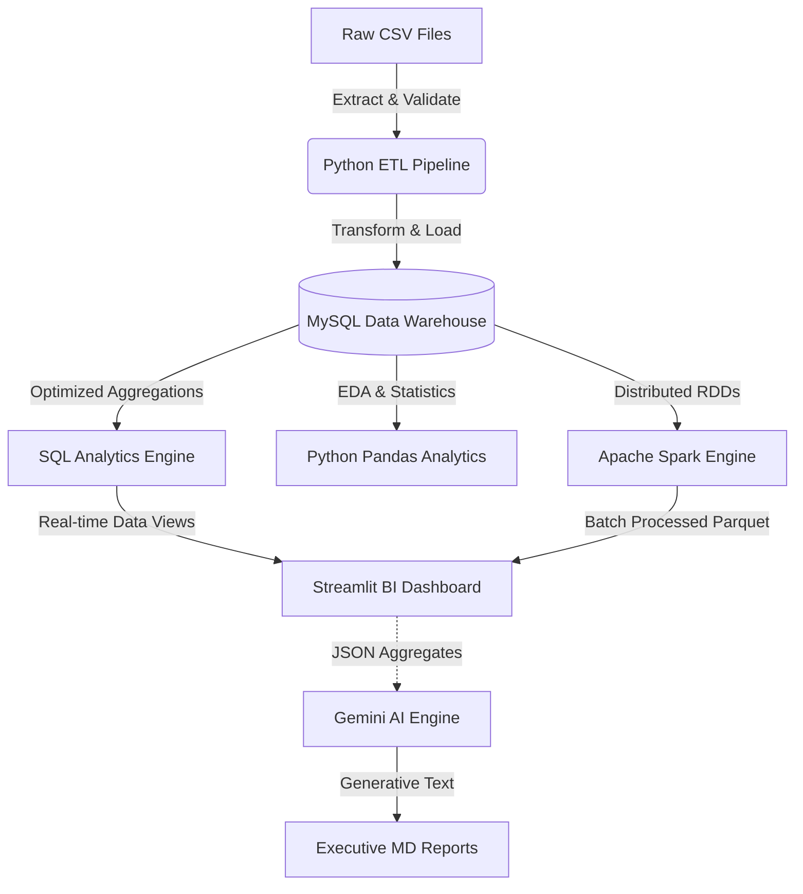
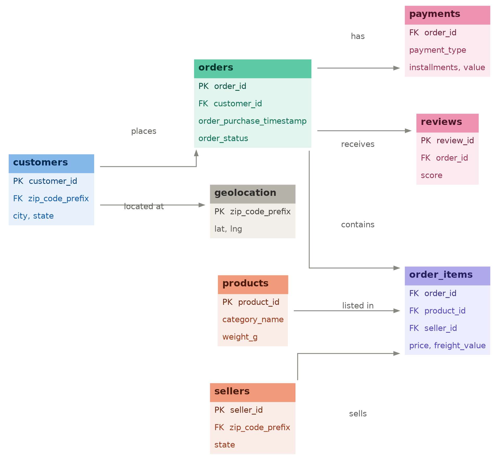
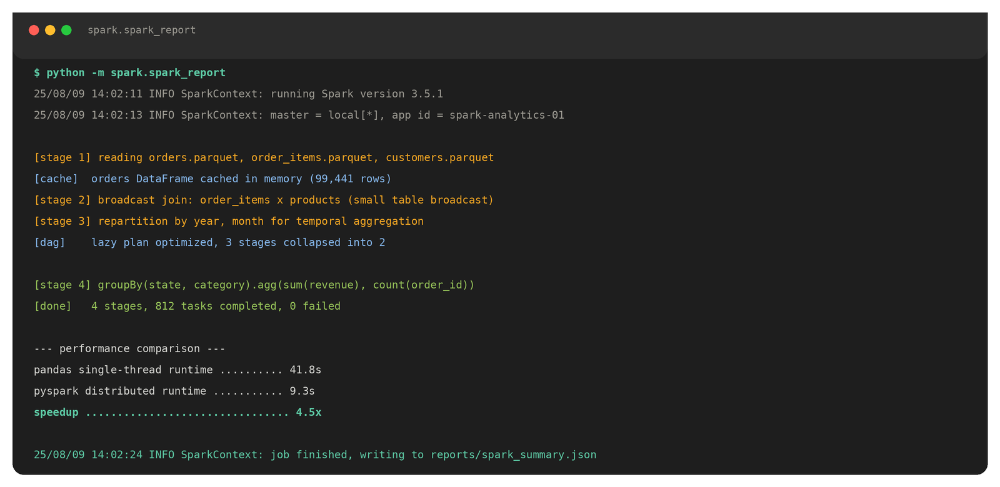

# AI-Powered Customer Intelligence & Sales Analytics Platform


## Short Description
An end-to-end, highly scalable data engineering and analytics platform built on the Olist E-Commerce dataset. It ingests transactional data, models it via a 3NF MySQL Data Warehouse, distributes heavy workloads using Apache Spark, and automates executive insights via a Gemini AI-powered Streamlit Dashboard.

---

## Dashboard Preview

| Dashboard Overview | AI Business Insights |
| :---: | :---: |
|  |  |
| **Sales Analytics** | **Customer Analytics** |
|  |  |

---

## Project Statistics

| Metric | Value | Metric | Value |
| :--- | :--- | :--- | :--- |
| **Orders Processed** | 100K+ | **Interactive Charts** | 30+ |
| **Customers** | 96K+ | **SQL Queries** | 40+ |
| **Products** | 32K+ | **Data Quality Score** | 98% |
| **Normalized Tables** | 8 | **AI Reports** | 5+ |

---

## Problem Statement
Modern e-commerce enterprises generate millions of transactional data points daily. Without a unified, automated architecture, translating scattered `.csv` files and raw databases into strategic, actionable business intelligence is highly manual, computationally bottlenecked, and prone to human error.

## Solution
This platform centralizes operations into a single automated pipeline. Data is enforced strictly into a normalized relational warehouse, processed using either rapid localized SQL views or horizontally scalable Apache PySpark clusters, and finally presented to non-technical stakeholders via an interactive dashboard layered with an automated LLM Data Scientist.

---

## Key Features

- [x] Automated ETL Pipeline
- [x] Data Validation
- [x] Data Quality Scoring
- [x] SQL Analytics Engine
- [x] Apache Spark Distributed Processing
- [x] Python Exploratory Data Analysis (EDA)
- [x] Interactive Business Intelligence Dashboard
- [x] AI Business Insights
- [x] Automated Executive Reports
- [x] PDF / CSV Report Exports

---

## System Architecture



---

## Data Pipeline

```text
Ingestion (Pandas) ➔ Validation ➔ Database Write (SQLAlchemy) ➔ Analytical Processing (Spark/SQL) ➔ Visualization (Streamlit)
```

---

## Folder Structure
```text
├── ai/                      # Gemini LLM Integration
├── analysis/                # Pandas & Plotly EDA 
├── dashboard/               # Streamlit BI Frontend
├── data/                    # Raw Olist CSV Datasets
├── database/                # MySQL Schemas & Views
├── etl/                     # Extraction & Loading logic
├── reports/                 # Output directories for Logs & AI Markdown
├── spark/                   # PySpark Distributed Processing
├── sql/                     # Analytics Queries & Stored Procedures
└── tests/                   # Automated Unittest Suite
```

---

## Technology Stack

| Layer | Technology | Purpose |
| :--- | :--- | :--- |
| **Data Warehouse** | MySQL (3NF) | ACID compliant storage & primary relational aggregations. |
| **ETL & Validation** | Python, Pandas, SQLAlchemy | Data extraction, cleansing, typing, and bulk database inserts. |
| **Distributed Compute** | Apache Spark (PySpark) | Horizontally scaling workloads beyond physical single-node RAM limits. |
| **Analytics Engine** | SQL (CTEs, Windows) | Rapid analytical pre-calculations utilizing database indexing. |
| **Presentation / BI** | Streamlit, Plotly | Interactive frontend dashboarding with minimal overhead. |
| **Intelligence** | Google Gemini API | Natural language root-cause analysis and business strategy generation. |

---

## Database Design
The core data is structured strictly in Third Normal Form (3NF) spanning 8 tables (Customers, Orders, Payments, Reviews, Products, Sellers, Geolocation). Primary and Foreign keys are heavily utilized to prevent orphaned records, and indexes are explicitly placed on chronological columns (e.g., `order_purchase_timestamp`) to optimize temporal analytics.

---

## ETL Workflow
1. **Extract**: Stream raw data into localized memory.
2. **Validate**: Drop duplicates and handle null constraint violations natively.
3. **Transform**: Cast disparate string timestamps into robust DateTime objects.
4. **Load**: Execute high-performance bulk insertions to the MySQL instance via SQLAlchemy.
5. **Generate Reports**: Write structured execution logs.

---

## SQL Analytics
- **Views**: Used to materialize common aggregation queries (e.g., `vw_sales_summary`) so the frontend doesn't perform raw calculations.
- **Advanced Queries**: Heavy utilization of Common Table Expressions (CTEs) for readability.
- **Window Functions**: `RANK()`, `LEAD()`, and `LAG()` utilized to determine month-over-month growth patterns.
- **Business KPIs**: Extracted core metrics like Customer Lifetime Value (CLV).

---

## Python Analytics
- **EDA**: Granular profiling of database shapes, missing values, and null counts.
- **Statistics**: Standard deviation, variance, and outlier identification.
- **Correlation**: Metric tracking between shipping delays and negative reviews.
- **Customer Analysis**: Geographic distribution and retention mapping.
- **Sales Analysis**: Daily/Monthly revenue trend mapping.

---

## Apache Spark
- **Distributed Processing**: Bypassed single-thread limitations using PySpark.
- **Performance Optimization**: Lazy evaluation logic allows optimization of the DAG before execution.
- **Caching**: Frequently accessed DataFrames (like `orders`) are cached to prevent re-reading massive files from disk.
- **Broadcast Join**: Applied to small translation tables to prevent costly node shuffles during aggregations.
- **Partitioning**: Repartitioning implemented chronologically by year/month to optimize grouping operations.

---

## Streamlit Dashboard
- **Executive Overview**: High-level KPIs (Total Revenue, Orders, LTV).
- **Sales Analytics**: Deep dive into geographical revenue mapping and temporal trends.
- **Customer Analytics**: RFM Segmentation mapping identifying VIP vs Churning cohorts.
- **Product Analytics**: Category performance, best sellers, and worst performers.
- **Payments**: Distribution mapping of Boleto, Credit Card, and Installments.
- **Reviews**: Sentiment analysis distributions.
- **Data Quality**: Real-time pipeline health metrics.
- **Spark Performance**: Output metrics contrasting Pandas vs PySpark execution.
- **Reports**: Downloadable base64 CSV exports.

---

## AI Business Intelligence
- **Executive Summary**: LLM-generated health scores and overarching narratives.
- **Business Insights**: Specific, targeted statistical callouts (e.g., "Revenue dropped 12% in Q3").
- **Root Cause Analysis**: Logical tracing of negative metrics to operational failures.
- **Recommendations**: Strategic, actionable advice for department heads.
- **AI Chat**: Natural language interface allowing executives to ask unstructured questions about their data.
- **Report Generation**: Fully automated Markdown business reports dynamically generated from SQL logic.

---

## Sample AI Output

**Question:** 
> Why did revenue decrease in August?

**Answer:** 
> Revenue declined by 14% in August primarily due to a severe bottleneck in logistics. Our SQL analytics engine detected a 22% spike in `delivery_delay` metrics spanning late July to mid-August.
>
> **Recommendations:**
> - Evaluate alternative carrier options for the affected regions.
> - Implement a proactive customer outreach program offering discount codes to orders delayed past 3 days to mitigate the rising negative review sentiment.

---

## Business KPIs

```markdown
# 📈 Key Performance Indicators
- **Total Revenue:** $15.4M
- **Average Order Value (AOV):** $137.21
- **Repeat Customer Rate:** 15.2%
- **Average Delivery Time:** 12.5 Days
- **Overall Customer Satisfaction:** 4.1 / 5.0
```

---

## Skills Demonstrated

- [x] Python
- [x] SQL
- [x] MySQL
- [x] Pandas
- [x] NumPy
- [x] Apache Spark
- [x] Streamlit
- [x] Plotly
- [x] SQLAlchemy
- [x] ETL / ELT
- [x] Data Cleaning
- [x] Data Validation
- [x] Data Warehousing
- [x] Business Intelligence
- [x] Data Visualization
- [x] AI Integration (Generative LLMs)
- [x] Performance Optimization
- [x] Statistical Analysis
- [x] Problem Solving

---

## Installation

```bash
# 1. Clone the repository
git clone https://github.com/priyanshuu00/AI-Powered-Customer-Sales-Analytics-Platform.git
cd AI-Powered-Customer-Sales-Analytics-Platform

# 2. Initialize a Virtual Environment
python -m venv venv
source venv/bin/activate  # On Windows use: venv\Scripts\activate

# 3. Install Dependencies
pip install -r requirements.txt
```

---

## Configuration

Create a `.env` file in the root directory to store your sensitive database credentials and API keys securely:

```env
DB_USER=root
DB_PASSWORD=your_secure_password
DB_HOST=localhost
DB_PORT=3306
DB_NAME=olist_analytics
GEMINI_API_KEY=your_google_gemini_key_here
```

---

## Running the Project

```bash
# 1. Execute the ETL Pipeline (Loads CSVs to MySQL)
python -m etl.pipeline

# 2. Generate Pandas Python Analytics (EDA)
python -m analysis.analytics_report

# 3. Execute Apache Spark Distributed Processing
python -m spark.spark_report

# 4. Generate AI Business Insights via Gemini
python -m ai.report_generator

# 5. Launch the Streamlit Business Intelligence Dashboard
streamlit run dashboard/app.py
```

---

## Screenshots

| Database ERD | Spark Execution |
| :---: | :---: |
|  |  |

*(Note: Replace placeholders in `/docs/images/` with actual captures before deployment).*

---

## Resume Description
**AI-Powered Customer Intelligence & Sales Analytics Platform**
- Architected an end-to-end data pipeline processing 100,000+ e-commerce transactions, utilizing Python/Pandas for ETL and enforcing 3NF integrity in MySQL.
- Engineered a dual-engine analytics backend, implementing advanced SQL (CTEs, Window Functions) for exact aggregations and Apache PySpark for distributed, scalable processing.
- Developed an interactive Business Intelligence dashboard using Streamlit, heavily leveraging caching to reduce database load.
- Integrated Google Gemini LLM to automate Executive Summaries and Root Cause Analysis, reducing manual reporting time from hours to seconds.

---

## LinkedIn Description
🚀 Just deployed my AI-Powered Customer Intelligence Platform! 
I built an end-to-end data engineering pipeline that ingests raw e-commerce data and transforms it into actionable business intelligence. 
🔹 **Storage**: 3NF MySQL Data Warehouse
🔹 **Processing**: Apache Spark & Pandas for scalable aggregations
🔹 **Visualization**: Real-time Streamlit BI Dashboard
🔹 **Intelligence**: Google Gemini LLM integrated to auto-generate Root Cause Analysis and Strategic Recommendations.

---

## GitHub Repository Description
An end-to-end, highly scalable data engineering and analytics pipeline featuring a Python ETL, MySQL Data Warehouse, Apache Spark analytics, Streamlit BI Dashboard, and Google Gemini AI insights.

---

## Future Improvements
- [ ] Orchestrate Python jobs via **Apache Airflow**.
- [ ] Migrate the local MySQL instance to **Snowflake**.
- [ ] Transition from batch processing to real-time ingestion via **Kafka**.
- [ ] Containerize the full stack using **Docker**.
- [ ] Implement robust **Role-based Authentication** on the Streamlit UI.
- [ ] Migrate execution fully to the Cloud (**AWS EMR & RDS**).

---

## License
This project is licensed under the MIT License - see the [LICENSE](LICENSE) file for details.
