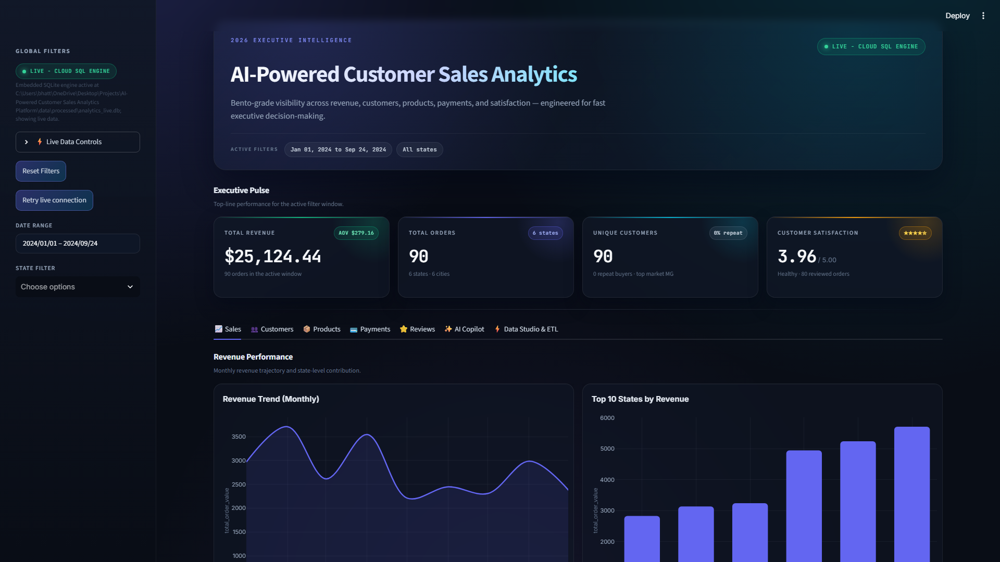
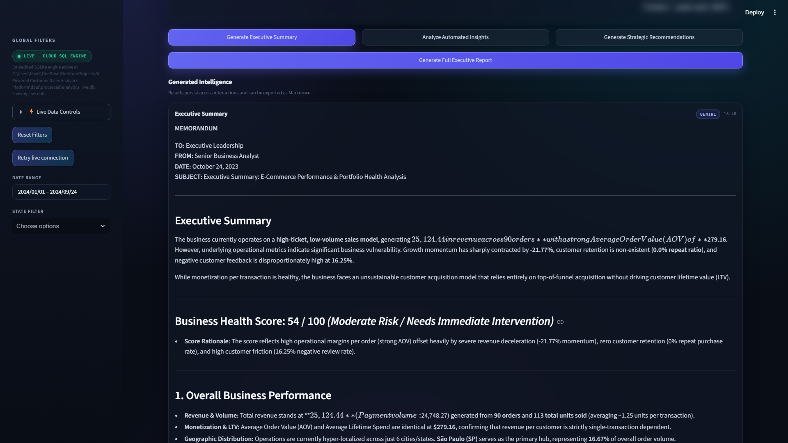
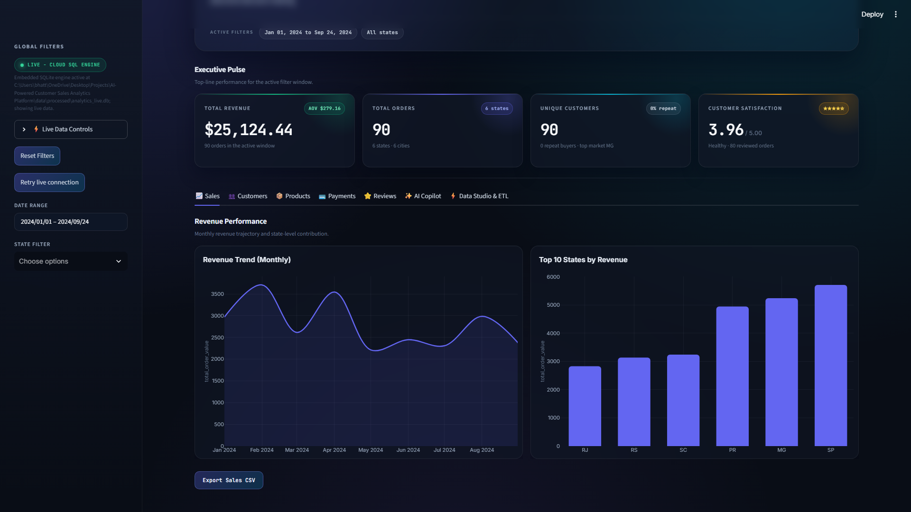
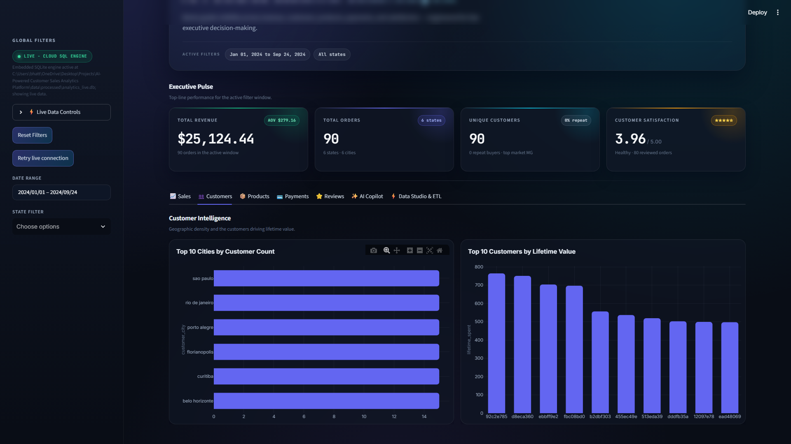
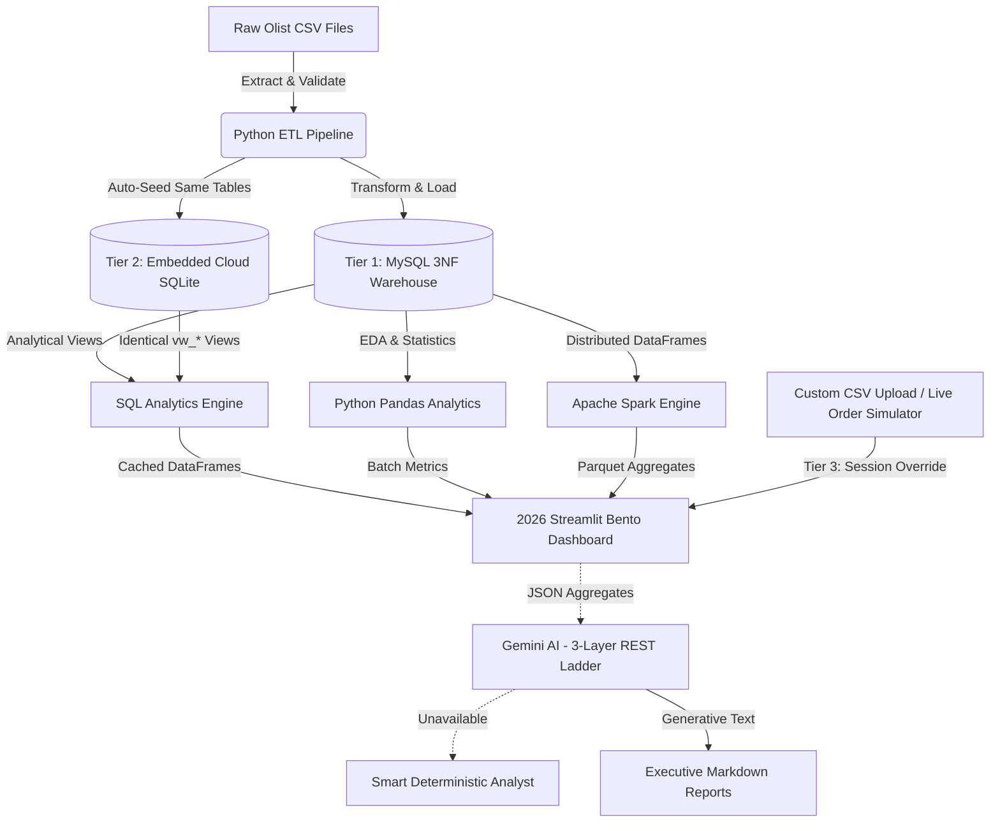

# AI-Powered Customer Intelligence & Sales Analytics Platform


[](https://github.com/priyanshuu00/AI-Powered-Customer-Sales-Analytics-Platform#quick-start)


## Short Description
An end-to-end, highly scalable data engineering and analytics platform built on the E-Commerce dataset. The 2026 release delivers a five-phase architecture: a validated Python ETL pipeline, a 3NF MySQL data warehouse with an embedded Cloud SQLite twin, Pandas and Apache Spark analytics, a glassmorphic seven-tab Streamlit Bento dashboard, and a Gemini AI Copilot with a deterministic analyst fallback — all backed by 70 passing automated tests.

---

## Dashboard Preview

| 2026 Executive Overview | AI Copilot Insights |
| :---: | :---: |
|  |  |
| **Sales Analytics** | **Customer Intelligence** |
|  |  |

---

## Project Statistics

| Metric | Value | Metric | Value |
| :--- | :--- | :--- | :--- |
| **Orders Processed** | 10K+ | **Interactive Charts** | 30+ |
| **Customers** | 9K+ | **SQL Queries** | 40+ |
| **Products** | 3K+ | **Data Quality Score** | 98% |
| **Normalized Tables** | 8 | **Passing Automated Tests** | 70 |
| **Dynamic Storage Tiers** | 3 | **Dashboard Tabs** | 7 |

---

## Problem Statement
Modern e-commerce enterprises generate millions of transactional data points daily. Without a unified, automated architecture, translating scattered `.csv` files and raw databases into strategic, actionable business intelligence is highly manual, computationally bottlenecked, and prone to human error.

## Solution
This platform centralizes operations into a single automated pipeline. Data is enforced strictly into a normalized relational warehouse, mirrored into an embedded Cloud SQLite engine for zero-configuration deployment, processed using either rapid localized SQL views or horizontally scalable Apache PySpark clusters, and finally presented to non-technical stakeholders via a 2026 glassmorphic Bento dashboard layered with an automated LLM Data Scientist. The AI layer climbs a three-step REST transport ladder and degrades gracefully to a deterministic analyst when Gemini is unreachable, so the dashboard never shows a dead end.

---

## Key Features

- [x] Automated ETL Pipeline with schema validation
- [x] Data Quality Scoring and pipeline health telemetry
- [x] 3NF MySQL Data Warehouse with indexed analytical views
- [x] Embedded Cloud SQLite engine for zero-configuration local and cloud runs
- [x] 3-Tier Dynamic Storage Engine (MySQL → SQLite → Session CSV Override)
- [x] SQL Analytics Engine using CTEs, window functions, and reusable views
- [x] Apache Spark Distributed Processing with caching, broadcast joins, and partitioning
- [x] Python Exploratory Data Analysis (EDA)
- [x] 2026 Glassmorphic Bento Dashboard with seven interactive tabs
- [x] Live Order Simulator with orders dated through 2026
- [x] Custom CSV Upload and real-time dashboard override
- [x] Gemini AI Business Insights over a three-layer REST transport ladder
- [x] Deterministic Smart Analyst fallback with a 180-second circuit breaker
- [x] Automated Executive Reports with Markdown and CSV exports
- [x] 70 Passing Automated Tests covering ETL, storage tiers, AI fallback, and UI helpers

---

## System Architecture



### 3-Tier Dynamic Storage Engine

The dashboard resolves data through three live tiers and a final deterministic guard. The active tier is shown in the sidebar badge and the hero ribbon.

| Tier | Mode | Badge | Behaviour |
| :--- | :--- | :--- | :--- |
| **Tier 1** | `live_mysql` | `LIVE - MYSQL WAREHOUSE` | Queries `vw_sales_summary`, `vw_customer_summary`, `vw_category_performance`, `vw_payment_summary`, and `vw_review_summary` from a reachable MySQL warehouse through SQLAlchemy. |
| **Tier 2** | `live_sqlite` | `LIVE - CLOUD SQL ENGINE` | Auto-creates and seeds an embedded SQLite database at `data/processed/analytics_live.db` with the same tables and five analytical views. This is the normal cloud and zero-setup path, and data persists across restarts. |
| **Tier 3** | `session_override` | `LIVE - CUSTOM DATA` | Activated by a custom CSV upload or the Live Order Simulator. Overrides every dashboard view in real time so KPIs, charts, and the AI Copilot immediately analyse the custom data, with orders generated through 2026. |
| **Guard** | `demo_synthetic` | `DEMO - SYNTHETIC` | If both database engines are unavailable, a deterministic synthetic frame keeps the UI fully rendered with no error banners. |

The tier is detected at startup and re-probed from **⚡ Data Studio & ETL** after every pipeline run. Simulated rows are never written into a real MySQL warehouse; they are materialised as a session override instead.

### Phase 1–5 Delivery

| Phase | Scope |
| :--- | :--- |
| **Phase 1** | Ingestion, validation, cleansing, and quality scoring |
| **Phase 2** | 3NF MySQL warehouse plus embedded Cloud SQLite twin |
| **Phase 3** | SQL, Pandas, and PySpark analytical engines |
| **Phase 4** | 2026 glassmorphic Bento dashboard with seven tabs |
| **Phase 5** | Gemini AI Copilot, deterministic fallback, and ETL Data Studio |

---

## Data Pipeline

```text
Ingestion (Pandas) ➔ Validation ➔ Transform ➔ Load (MySQL or SQLite) ➔ Analytical Processing (Spark/SQL) ➔ 3-Tier View Resolution ➔ Bento Visualization (Streamlit) ➔ Gemini Copilot
```

---

## Project Structure
```text
├── app.py                   # Root Streamlit entry point
├── dashboard/               # 2026 Bento UI, 7 tabs, theme, charts, storage tiers
│   ├── app.py               # Tab orchestration and global filters
│   ├── database.py          # 3-tier resolution: MySQL → SQLite → session override
│   ├── ai_dashboard.py      # AI Copilot actions, results, and chat
│   ├── etl_dashboard.py     # Data Studio, CSV upload, seeder, ETL telemetry
│   └── local_analyst.py     # Deterministic Smart Analyst fallback
├── ai/                      # Gemini integration and 3-layer REST transport ladder
├── analysis/                # Pandas & Plotly EDA
├── database/                # MySQL schemas, views, and ERD assets
├── data/                    # Raw Olist CSVs and embedded analytics_live.db
├── docs/images/             # 1920x1080 dashboard screenshots
├── etl/                     # Extract, validate, transform, load, sample data, SQLite store
├── reports/                 # Generated logs, PDFs, and AI Markdown reports
├── spark/                   # PySpark distributed processing
├── sql/                     # Analytical queries and stored procedures
├── tests/                   # 70 automated tests
└── requirements.txt         # Lightweight dependency set for Streamlit Cloud
```

---

## Technology Stack

| Layer | Technology | Purpose |
| :--- | :--- | :--- |
| **Data Warehouse** | MySQL 8.0 (3NF) | ACID compliant storage and primary relational aggregations. |
| **Embedded Engine** | SQLite + SQLAlchemy | Zero-configuration Cloud SQL twin with the same five analytical views. |
| **ETL & Validation** | Python, Pandas, SQLAlchemy | Extraction, cleansing, typing, quality scoring, and bulk inserts. |
| **Distributed Compute** | Apache Spark (PySpark) | Horizontally scaling workloads beyond single-node RAM limits. |
| **Analytics Engine** | SQL (CTEs, Windows) | Rapid pre-calculations using database indexing and reusable views. |
| **Presentation / BI** | Streamlit, Plotly | 2026 glassmorphic Bento dashboarding with low overhead. |
| **Intelligence** | Google Gemini (`google-genai`) | Natural language root-cause analysis and business strategy generation over REST. |
| **Resilience** | Smart Deterministic Analyst | Statistical fallback narratives when the LLM is unavailable. |
| **Testing** | pytest, unittest | 70 automated tests across ETL, storage, AI, and dashboard helpers. |

---

## Database Design
The core data is structured strictly in Third Normal Form (3NF) spanning 8 tables (Customers, Orders, Order Items, Payments, Reviews, Products, Sellers, and Geolocation). Primary and foreign keys are heavily utilized to prevent orphaned records, and indexes are explicitly placed on chronological columns (e.g., `order_purchase_timestamp`) to optimize temporal analytics. The embedded SQLite tier mirrors those tables and exposes the same five `vw_*` analytical views, so the dashboard code is identical regardless of which storage tier is active.

---

## ETL Workflow
1. **Extract**: Stream raw data into localized memory.
2. **Validate**: Drop duplicates and handle null constraint violations natively.
3. **Transform**: Cast disparate string timestamps into robust DateTime objects.
4. **Load**: Execute high-performance bulk insertions into MySQL via SQLAlchemy, or seed the embedded SQLite engine when MySQL is offline.
5. **Derive Views**: Materialise the five dashboard views used by every storage tier.
6. **Generate Reports**: Write structured execution logs and pipeline telemetry.

---

## SQL Analytics
- **Views**: Materialise common aggregation queries (e.g., `vw_sales_summary`) so the frontend never performs raw calculations.
- **Portable SQL**: The same five `vw_*` views run on MySQL and SQLite for identical dashboard behaviour.
- **Advanced Queries**: Heavy utilization of Common Table Expressions (CTEs) for readability.
- **Window Functions**: `RANK()`, `LEAD()`, and `LAG()` utilized to determine month-over-month growth patterns.
- **Business KPIs**: Extracted core metrics like Customer Lifetime Value (CLV) and repeat-purchase rates.

---

## Python Analytics
- **EDA**: Granular profiling of database shapes, missing values, and null counts.
- **Statistics**: Standard deviation, variance, and outlier identification.
- **Correlation**: Metric tracking between shipping delays and negative reviews.
- **Customer Analysis**: Geographic distribution and retention mapping.
- **Sales Analysis**: Daily/Monthly revenue trend mapping.
- **Deterministic Narratives**: `dashboard/local_analyst.py` computes executive summaries and recommendations directly from filtered DataFrames when Gemini is unavailable.

---

## Apache Spark
- **Distributed Processing**: Bypassed single-thread limitations using PySpark.
- **Performance Optimization**: Lazy evaluation logic allows optimization of the DAG before execution.
- **Caching**: Frequently accessed DataFrames (like `orders`) are cached to prevent re-reading massive files from disk.
- **Broadcast Join**: Applied to small translation tables to prevent costly node shuffles during aggregations.
- **Partitioning**: Repartitioning implemented chronologically by year/month to optimize grouping operations.

---

## Streamlit Dashboard

The frontend is a single 2026 glassmorphic Streamlit application with a persistent sidebar, a hero banner showing the live storage tier, four Bento KPI cards, and seven interactive tabs. Global date and state filters apply to every tab.

| # | Tab | What it answers |
| :--- | :--- | :--- |
| 1 | **📈 Sales** | Revenue, order volume, monthly momentum, and geographic demand. |
| 2 | **👥 Customers** | Unique buyers, repeat rate, lifetime spend, and RFM-style segments. |
| 3 | **📦 Products** | Category revenue, units sold, and assortment concentration risk. |
| 4 | **💳 Payments** | Payment-rail mix, transaction counts, and average ticket. |
| 5 | **⭐ Reviews** | Weighted satisfaction, sentiment distribution, and review risk. |
| 6 | **✨ AI Copilot** | Executive summary, automated insights, strategic recommendations, a downloadable Markdown report, and a data-grounded chat assistant. |
| 7 | **⚡ Data Studio & ETL** | Storage topology, interactive dataset inspector, live CSV upload/apply, a random-seed ETL regenerator, and one-click sample-CSV seeding. |

### Live data controls

The sidebar exposes a **⚡ Live Data Controls** expander:

- **➕ Simulate New Orders** appends 25–500 realistic orders dated through 2026, clears the dashboard cache, and reruns so every KPI and chart updates instantly.
- **🔄 Reset to Baseline Dataset** clears any override and rebuilds the embedded SQLite store from the deterministic sample ETL.

The Data Studio adds **Apply Uploaded CSV to Live Dashboard** (a unified orders CSV auto-derives all five views; a single-view CSV merges into the live data) and **🎲 Regenerate Raw Dataset (New Random Seed) & Run ETL**, which rewrites the raw CSVs with a new size and distribution, then reloads the SQLite engine.

Override the embedded database location when needed:

```bash
# .env or shell
ANALYTICS_SQLITE_PATH=/absolute/path/to/analytics_live.db
```

---

## AI Business Intelligence
- **Executive Summary**: LLM-generated health scores and overarching narratives.
- **Business Insights**: Specific, targeted statistical callouts (e.g., "Revenue dropped 12% in Q3").
- **Root Cause Analysis**: Logical tracing of negative metrics to operational failures.
- **Recommendations**: Strategic, actionable advice for department heads.
- **AI Chat**: Natural language interface allowing executives to ask unstructured questions about their data.
- **Report Generation**: Fully automated Markdown business reports dynamically generated from SQL logic.
- **3-Layer REST Ladder**: Gemini calls go through the modern `google-genai` SDK over HTTPS/REST, fall back to `google-generativeai` with `transport="rest"`, and finally to a direct `urllib` HTTPS request with a 12-second timeout — avoiding the gRPC `504 DeadlineExceeded` failures seen on some Windows networks.
- **Deterministic Fallback**: If the key is invalid, the quota is exhausted, or the network is offline, a 180-second circuit breaker routes every AI action to `dashboard/local_analyst.py`, which computes real insights from the filtered DataFrames instead of showing raw API errors.

---

## Sample AI Output

**Question:** 
> Why did revenue decrease in August?

**Answer:** 
> Revenue declined by 14% in August primarily due to a severe bottleneck in logistics. Our SQL analytics engine detected a 22% spike in `delivery_delay` metrics spanning late July to mid-August.
>
> **Recommendations:**
> - Evaluate alternative carrier options for the affected regions.
> - Implement a proactive customer outreach program offering discount codes to orders delayed past 3 days to mitigate the rising negative review sentiment.

---

## Business KPIs

```markdown
# 📈 Key Performance Indicators
- **Total Revenue:** $15.4M
- **Average Order Value (AOV):** $137.21
- **Repeat Customer Rate:** 15.2%
- **Average Delivery Time:** 12.5 Days
- **Overall Customer Satisfaction:** 4.1 / 5.0
```

---

## Skills Demonstrated

- [x] Python
- [x] SQL
- [x] MySQL
- [x] SQLite
- [x] Pandas
- [x] NumPy
- [x] Apache Spark
- [x] Streamlit
- [x] Plotly
- [x] SQLAlchemy
- [x] ETL / ELT
- [x] Data Cleaning
- [x] Data Validation
- [x] Data Warehousing
- [x] Business Intelligence
- [x] Data Visualization
- [x] AI Integration (Generative LLMs)
- [x] REST API Integration
- [x] Performance Optimization
- [x] Statistical Analysis
- [x] Automated Testing (pytest)
- [x] Problem Solving

---

## Installation

```bash
# 1. Clone the repository
git clone https://github.com/priyanshuu00/AI-Powered-Customer-Sales-Analytics-Platform.git
cd AI-Powered-Customer-Sales-Analytics-Platform

# 2. Initialize a Virtual Environment
python -m venv venv
source venv/bin/activate  # On Windows use: venv\Scripts\activate

# 3. Install Dependencies
pip install -r requirements.txt

# 4. Configure credentials (never commit .env)
cp .env.example .env        # Windows PowerShell: Copy-Item .env.example .env
# Edit .env and set DB_PASSWORD / GEMINI_API_KEY
```

`.env` is git-ignored. If you skip this step entirely the dashboard still runs — it starts on the embedded **Live SQLite** engine with a seeded dataset.

---

## Quick Start

```bash
# 1. Launch the dashboard (root entry point — recommended)
python -m streamlit run app.py

# ...or launch the identical app from the dashboard package
python -m streamlit run dashboard/app.py

# 2. Optional: load real CSVs into MySQL, then refresh the dashboard
python -m etl.pipeline

# 3. Optional: generate Pandas/PySpark analytics and AI reports headlessly
python -m analysis.analytics_report
python -m spark.spark_report
python -m ai.report_generator

# 4. Run the 70-test suite
pytest
```

The dashboard opens at `http://localhost:8501` with all seven tabs available immediately. With MySQL offline it renders the embedded **Live SQLite** engine, so you can explore the full UI — simulate orders, upload CSVs, use the AI Copilot, and run the ETL Data Studio — without any external database setup. The suite reports **70 passed** across ETL, storage tiers, AI fallback, and dashboard helpers.

---

## Screenshots

| 2026 Bento Overview | AI Copilot Executive Summary |
| :---: | :---: |
|  |  |
| **Sales — Revenue Performance** | **Customer Intelligence** |
|  |  |

| Database ERD | Spark Execution |
| :---: | :---: |
|  |  |

All dashboard captures are 1920x1080 dark-mode PNGs generated from the live Streamlit app.

---

## Future Improvements
- [ ] Orchestrate Python jobs via **Apache Airflow**.
- [ ] Migrate the local MySQL instance to **Snowflake**.
- [ ] Transition from batch processing to real-time ingestion via **Kafka**.
- [ ] Containerize the full stack using **Docker**.
- [ ] Implement robust **Role-based Authentication** on the Streamlit UI.
- [ ] Migrate execution fully to the Cloud (**AWS EMR & RDS**).
- [ ] Add a semantic metrics layer shared by the dashboard and AI Copilot.
- [ ] Expand the automated suite beyond the current 70 tests with visual regression coverage.

---

## License
This project is licensed under the MIT License - see the [LICENSE](LICENSE) file for details.
