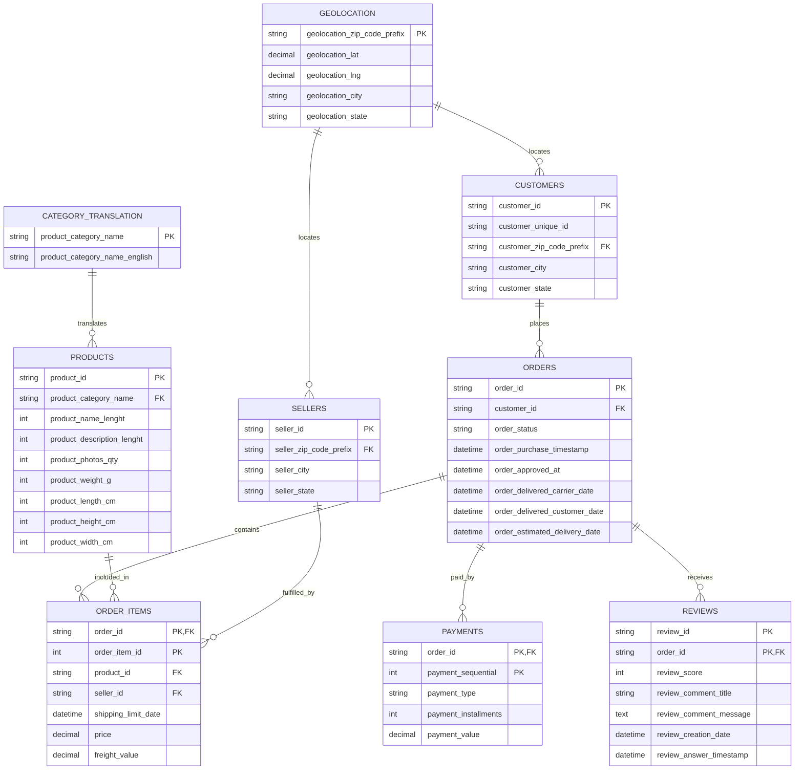

# Phase 2: Project Planning & Database Design

## 1. Project Planning

### Project Overview
The AI-Powered Customer Sales Analytics Platform is a scalable data infrastructure and analytics application designed to ingest e-commerce data and extract actionable business insights. Using the comprehensive Olist Brazilian E-Commerce dataset, the platform will model customer behavior, identify key sales trends, and provide business recommendations driven by data and machine learning. 

### Business Problem
E-commerce businesses struggle to translate raw operational data—such as order histories, shipping logistics, and customer reviews—into cohesive, strategic insights. Without unified analytics, businesses face missed revenue opportunities, suboptimal logistics, and a lack of understanding regarding customer retention and satisfaction.

### Project Objectives
- Centralize disparate e-commerce data sets into a structured, highly optimized relational database.
- Establish a solid architectural foundation that supports subsequent phases like ETL automation and real-time dashboarding.
- Model the data to allow for complex queries on cohort retention, geographical logistics, and product category performance.

### Expected Business Outcomes
- Clear visualization of sales trends, seasonality, and high-performing product categories.
- Identification of logistical bottlenecks to improve delivery times.
- Insights into customer satisfaction and their root causes, enabling targeted improvements.

### Target Users
- **Data Analysts / Scientists**: To query cleaned data for ML models and custom reporting.
- **Business Operations Managers**: To track logistics (shipping times, freight costs) and seller performance.
- **Marketing / CRM Teams**: To identify high-value customer cohorts and improve retention.

### Key Performance Indicators (KPIs)
- **Total Revenue (GMV)** and Monthly Recurring Revenue (MRR).
- **Customer Lifetime Value (CLV)** and Repeat Purchase Rate.
- **Average Order Value (AOV)** and Cart Abandonment insights.
- **Average Delivery Time** vs Estimated Delivery Time.
- **Average Customer Satisfaction Score** (CSAT) based on reviews.

---

## 2. Dataset Planning

We will utilize the **Olist Brazilian E-Commerce Dataset**.

### Explanation of Datasets (CSV Files)
1. **olist_customers_dataset.csv**: Contains information about the customer and their location. `customer_id` is unique per order, while `customer_unique_id` identifies the actual person.
2. **olist_geolocation_dataset.csv**: Provides Brazilian zip codes and their corresponding lat/lng coordinates, cities, and states.
3. **olist_order_items_dataset.csv**: Details the items purchased within each order. Includes product IDs, seller IDs, item price, and freight value.
4. **olist_payments_dataset.csv**: Details payment methods (credit card, boleto, etc.), installments, and transaction values for each order.
5. **olist_reviews_dataset.csv**: Customer feedback including score (1-5), review title, text message, and timestamps.
6. **olist_orders_dataset.csv**: Core table containing order statuses (delivered, shipped) and crucial timestamps (purchase, approval, delivery).
7. **olist_products_dataset.csv**: Product characteristics such as category, name length, description length, and physical dimensions.
8. **olist_sellers_dataset.csv**: Information about the merchants fulfilling the orders, including their location (zip code).
9. **product_category_name_translation.csv**: Translates the Portuguese product categories to English.

### Data Relationships
- The **orders** dataset is the central hub. Every transaction ties back to an `order_id`.
- **Customers** and **Orders** link 1-to-many.
- **Orders** and **Order_Items** link 1-to-many.
- **Products** and **Sellers** link to **Order_Items** (a single item involves one product and one seller).
- **Payments** and **Reviews** link directly back to the **Orders** table.
- **Geolocation** acts as a central lookup reference for zip codes present in **Customers** and **Sellers**.

---

## 3. Database Design

We employ a Normalized Relational Database (3NF) to ensure data integrity and avoid redundancy.

### ER Diagram

### Table Definitions

#### 1. geolocation
- **Purpose**: Lookup table for geographical coordinates by zip code.
- **Columns**: `geolocation_zip_code_prefix` (VARCHAR), `geolocation_lat` (DECIMAL), `geolocation_lng` (DECIMAL), `geolocation_city` (VARCHAR), `geolocation_state` (CHAR).
- **PK**: `geolocation_zip_code_prefix`.

#### 2. category_translation
- **Purpose**: Maps Portuguese category names to English.
- **Columns**: `product_category_name` (VARCHAR), `product_category_name_english` (VARCHAR).
- **PK**: `product_category_name`.

#### 3. customers
- **Purpose**: Stores information about users making purchases.
- **Columns**: `customer_id` (VARCHAR), `customer_unique_id` (VARCHAR), `customer_zip_code_prefix` (VARCHAR), `customer_city` (VARCHAR), `customer_state` (CHAR).
- **PK**: `customer_id`.
- **FK**: `customer_zip_code_prefix` -> `geolocation(geolocation_zip_code_prefix)`.

#### 4. sellers
- **Purpose**: Stores information about the merchants.
- **Columns**: `seller_id` (VARCHAR), `seller_zip_code_prefix` (VARCHAR), `seller_city` (VARCHAR), `seller_state` (CHAR).
- **PK**: `seller_id`.
- **FK**: `seller_zip_code_prefix` -> `geolocation(geolocation_zip_code_prefix)`.

#### 5. products
- **Purpose**: Details characteristics of items available on the platform.
- **Columns**: `product_id` (VARCHAR), `product_category_name` (VARCHAR), `product_name_lenght` (INT), `product_description_lenght` (INT), `product_photos_qty` (INT), dimensions/weight (INT).
- **PK**: `product_id`.
- **FK**: `product_category_name` -> `category_translation(product_category_name)`.

#### 6. orders
- **Purpose**: The core table recording when transactions happened and their status.
- **Columns**: `order_id` (VARCHAR), `customer_id` (VARCHAR), `order_status` (VARCHAR), multiple timestamps (DATETIME).
- **PK**: `order_id`.
- **FK**: `customer_id` -> `customers(customer_id)`.

#### 7. order_items
- **Purpose**: Line items representing each product in a given order.
- **Columns**: `order_id` (VARCHAR), `order_item_id` (INT), `product_id` (VARCHAR), `seller_id` (VARCHAR), `shipping_limit_date` (DATETIME), `price` (DECIMAL), `freight_value` (DECIMAL).
- **PK**: Composite (`order_id`, `order_item_id`).
- **FKs**: `order_id` -> `orders`, `product_id` -> `products`, `seller_id` -> `sellers`.

#### 8. payments
- **Purpose**: Captures how each order was funded.
- **Columns**: `order_id` (VARCHAR), `payment_sequential` (INT), `payment_type` (VARCHAR), `payment_installments` (INT), `payment_value` (DECIMAL).
- **PK**: Composite (`order_id`, `payment_sequential`).
- **FK**: `order_id` -> `orders(order_id)`.

#### 9. reviews
- **Purpose**: Stores customer satisfaction feedback.
- **Columns**: `review_id` (VARCHAR), `order_id` (VARCHAR), `review_score` (INT), `review_comment_title` (VARCHAR), `review_comment_message` (TEXT), timestamps (DATETIME).
- **PK**: Composite (`review_id`, `order_id`).
- **FK**: `order_id` -> `orders(order_id)`.
- **Constraints**: CHECK `review_score` BETWEEN 1 AND 5.

---

## 4. Scalability for Future Phases
The normalized relational structure sets a robust foundation:
- **ETL (Phase 3)**: Clean foreign keys allow for efficient upserts and dependency validation during load phases.
- **PySpark**: Complex JOINs can be scaled horizontally. `order_purchase_timestamp` and `customer_unique_id` are indexed for partitioning.
- **SQL Analytics & Streamlit**: The database structure easily translates to aggregated views (e.g., Daily Revenue, Category Sales) ensuring fast analytical queries.
- **AI Forecasting & ML**: `customer_unique_id` aggregation helps formulate CLV models. Product metadata and reviews are perfectly suited for NLP analysis (sentiment) and recommendation engines.
